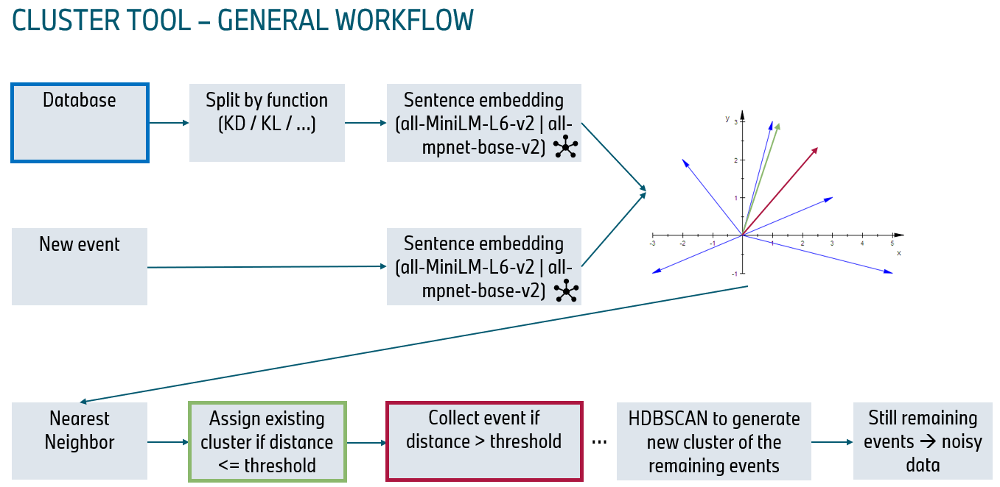
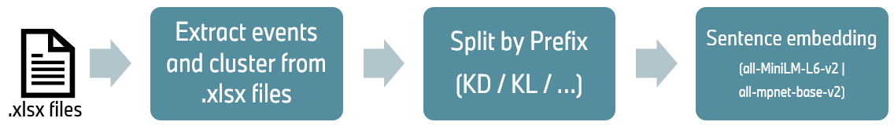

# ClustAI
Github repository of ClustAI.
ClustAI is an AI based clustering approach for textual notes.

## Prerequisites
1) Database that contains labeled 'Note' and 'Cluster' pairs.
2) Pretrained sentence embedding model (all-MiniLM-L6-v2, all-mpnet-base-v2, ...). Finteune pretrained model according to your database (finetune_SBERT_model.py).
3) .xlsx file that contains new notes.

## General Workflow

1) Data Preprocessing

Events/notes and clusters are extracted from the database .xlsx file and stored in seperate lists.
Afterwards the notes and cluster pairs are split by their prefix (KD / KL / ... are internal OEM's terms) to get a better sentence embedding performance.
Next the sentence embedding with the model is performed.
2) Given the new .xlsx file the same data processing steps are performed as in data preprocessing (extraction, split by prefix, sentence embedding).
3) Nearest neighbor approach to find the closest vector to each new note (cosine distance threshold of 0.05 is applied).
4) Assign cluster if distance is <= cosine distance threshold.
5) Create new cluster if distance > cosine distance threshold (done via HDBSCAN).

## Results
Five different .xlsx files were analyzed and mean is reported:
-> 73.14% of notes correctly clustered
-> 8.36% of notes incorrectly clustered
-> 18.5% noisy notes

Note - if a note is moved to an existing cluster (28% of the analyzed notes):
=> 99.8% probability of correctly clustering notes to existing clusters (very high reliability).

